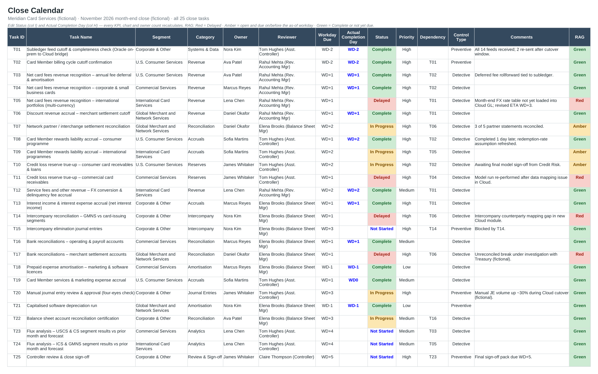
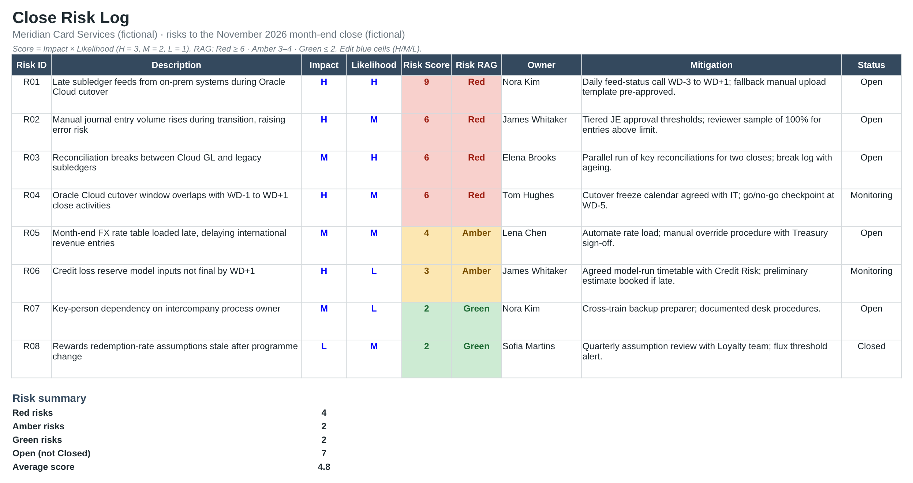

# Month-End Close Tracker – Card Issuer Close Simulation

A Python-built Excel tracker that gives finance leadership a live view of month-end close progress during an **Oracle on-premises to Oracle Cloud migration**. It covers 25 close tasks for a fictional card issuer, organised by reportable segment, with KPIs, RAG status, a risk log and owner accountability, all driven by Excel formulas so the workbook updates as preparers change task statuses.


> **Disclaimer:** Fictional company and data for portfolio purposes. Structure inspired by public information in American Express's Form 10-K. Not affiliated with or endorsed by American Express. Contains no confidential data.

---

## Key features

- **Leadership Summary:** KPI tiles, an overall close RAG, a status-by-segment table and stacked bar chart, and a cumulative planned vs actual completion line chart from WD-2 to WD+5.
- **Live formulas:** every KPI, RAG, segment count, owner count and chart series is a COUNTIFS, MINIFS or IF formula on the task list. No values are hard-coded.
- **Editable inputs:** the as-of workday and the Amber/Red RAG thresholds are yellow input cells. Changing them moves the close forward or tightens tolerance.
- **Close Calendar:** 25 tasks with frozen headers, filters on every column, dropdowns for Status/Priority/Control Type, and RAG conditional formatting.
- **Risk Log:** 8 ERP-transition risks scored Impact × Likelihood, with RAG formatting and a summary block.
- **Owner View:** open, delayed and high-priority open tasks per preparer, earliest open due day, owner RAG, and a chart.
- **Reproducible:** two scripts rebuild the data and the workbook from scratch. The data generator validates itself (task count, delay share, dependencies, status consistency).

## Headline results

| | |
|---|---|
| Close tasks | **25** across 4 reportable segments plus Corporate & Other |
| Live KPIs (as of WD+2) | **48%** complete · **4** delayed (16%) · **10** high-priority open |
| RAG logic | Overall close **Amber**. Red if % delayed ≥ 20%, Amber if ≥ 5% (both editable) |
| Risk log | **8** risks: 4 Red, 2 Amber, 2 Green |
| Formula integrity | **166** formulas, **0** errors after a full LibreOffice recalculation |
| Validation | Every KPI, segment, owner and risk value matches an independent pandas calculation. An edit test (Delayed → Complete) updated all dependent KPIs |

<details>
<summary>Close Calendar and Risk Log screenshots</summary>





</details>

---

## How to run

Requires Python 3.11+.

```bash
python -m venv .venv
source .venv/bin/activate
pip install -r requirements.txt
```

```bash
python src/generate_data.py
python src/build_tracker.py
```

Output: `output/Month_End_Close_Tracker.xlsx`. Open it in Excel. LibreOffice and Google Sheets also work.

**Try it:** on *Close Calendar*, change T05 from `Delayed` to `Complete` and enter `3` in its Actual Completion Day. The % complete, # delayed, overall RAG, segment chart, planned-vs-actual line and Owner View all update.

### Folder structure

```
├── src/
│   ├── generate_data.py   # builds + validates the fictional sample data -> data/*.csv
│   └── build_tracker.py   # reads the CSVs, writes the formatted, formula-driven workbook
├── data/
│   ├── close_tasks.csv          # 25 close tasks
│   ├── risk_log.csv             # 8 close risks
│   └── reference_structure.csv  # verified 10-K segment & revenue-line names
├── output/
│   └── Month_End_Close_Tracker.xlsx
├── screenshots/
├── requirements.txt
└── README.md
```

---

## Sheet guide

| # | Sheet | What it shows |
|---|-------|---------------|
| 1 | **Leadership Summary** | Disclaimer banner. Editable inputs: as-of workday and RAG thresholds. KPI tiles: total tasks, % complete, # delayed, # high-priority open, and the **overall close RAG**. A status-by-segment table with a stacked bar chart. A cumulative **planned vs actual completion** table with a line chart from WD-2 to WD+5. |
| 2 | **Close Calendar** | All 25 tasks: Task ID, Task Name, Segment, Category, Owner, Reviewer, Workday Due, Actual Completion Day, Status, Priority, Dependency, Control Type, Comments, plus a formula-driven RAG column. Red = Delayed, Amber = open and due on/before the as-of day, Green = complete or not yet due. |
| 3 | **Risk Log** | 8 close risks. Risk Score = Impact × Likelihood (H=3, M=2, L=1). RAG: Red ≥ 6, Amber 3–4, Green ≤ 2. Includes a risk summary block. |
| 4 | **Owner View** | For each preparer: total assigned, complete, open, delayed, high-priority open, earliest open due day (MINIFS) and an owner RAG, plus an open-vs-delayed column chart. |
| 5 | **About & Sources** | Disclaimer, the 10-K citation (fiscal year + URL), and a breakdown of what is real (public structure) versus fictional (everything else). |

### Key formulas

- `% complete` → `=COUNTIFS(Status,"Complete")/Total`
- `# high-priority open` → `=COUNTIFS(Priority,"High",Status,"<>Complete")`
- Overall RAG → `=IF(Delayed/Total>=RedThreshold,"Red",IF(Delayed/Total>=AmberThreshold,"Amber","Green"))`
- Planned (cumulative) → `=COUNTIFS(WorkdayDue,"<="&WD)`; Actual → `=COUNTIFS(Status,"Complete",ActualDay,"<="&WD)`
- Risk score → nested `IF` mapping H/M/L to 3/2/1, multiplied together

Workdays are stored as integers (for example `-2`, `0`, `5`) and displayed as `WD-2`, `WD0`, `WD+5` using a custom number format. This keeps them sortable and usable in COUNTIFS.

---

## Skills demonstrated

- **Record-to-report / month-end close process design** for a card issuer: revenue recognition (card fee deferral, discount revenue), rewards liability, credit loss reserves, network settlement, intercompany, bank recs, flux analysis and controller sign-off. Each task has dependencies and preventive/detective control types.
- **Leadership reporting:** KPI design, RAG frameworks with documented thresholds, and segment and owner accountability views.
- **Risk management:** an impact × likelihood scoring model with mitigations tied to ERP transition risks.
- **Excel engineering:** live COUNTIFS/MINIFS formulas, cross-sheet references, conditional formatting, data validation, frozen panes, AutoFilter and native Excel charts.
- **Python automation:** pandas for data generation and validation, openpyxl for workbook construction. The build is fully reproducible.
- **Source discipline:** public data was checked against the primary SEC filing and cited. Anything unverifiable was left out. Real and fictional content are clearly separated.

---

## Data sources & disclaimer

### Business context

Meridian Card Services (fictional) is moving its general ledger from Oracle on-premises (EBS) to Oracle Cloud. During the transition, subledger feeds arrive late, manual journal volume rises, reconciliations break between the new Cloud GL and legacy subledgers, and leadership loses the visibility the old close checklist gave. This tracker answers the four questions the Controller and CFO ask every day of the close: **Are we on track? What is late? Who is it waiting on? What could still derail sign-off?**

### Real vs fictional

**Real (public structure only)**, verified against American Express's **Form 10-K for the fiscal year ended December 31, 2025**, filed 6 February 2026:
<https://www.sec.gov/Archives/edgar/data/4962/000000496226000080/axp-20251231.htm>

- Reportable operating segments: *U.S. Consumer Services*, *Commercial Services*, *International Card Services*, *Global Merchant and Network Services*. *Corporate & Other* is used as a separate bucket. The 10-K says it is **not** a reportable segment.
- Revenue line names (MD&A Table 2): *Discount revenue*, *Net card fees*, *Service fees and other revenue*, *Total interest income*, *Total interest expense*, *Net interest income*.
- "Processed revenue" is intentionally excluded. The FY2025 10-K says it was folded into Service fees and other revenue starting in Q1 2025.

**Fictional:** the company, all task names, owners, reviewers, workdays, statuses, comments, risks and the Oracle migration scenario. No financial figures from the 10-K are used, and the workbook contains no real balances.

---

*Fictional company and data for portfolio purposes. Structure inspired by public information in American Express's Form 10-K. Not affiliated with or endorsed by American Express. Contains no confidential data.*
